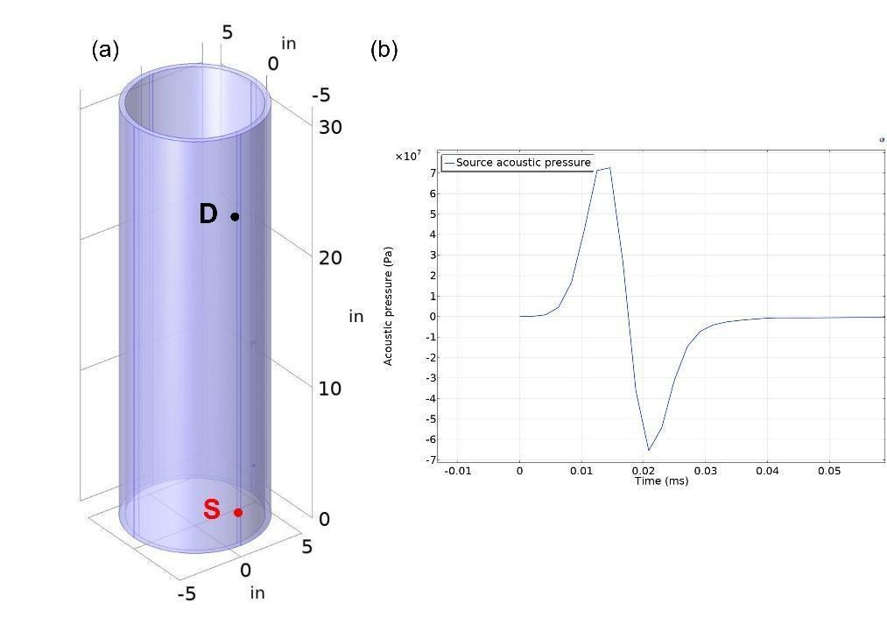
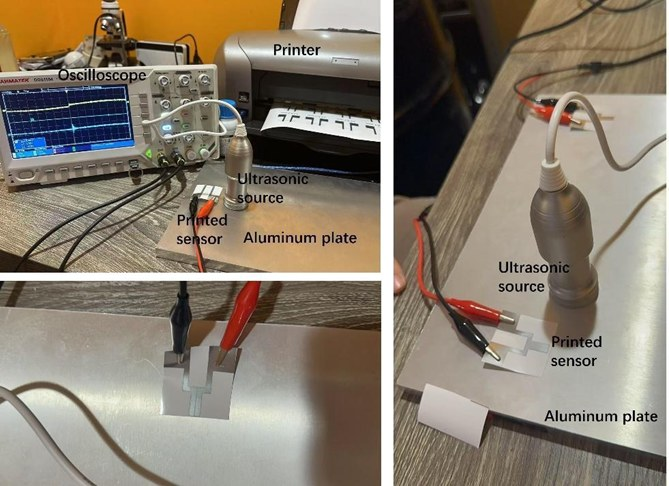
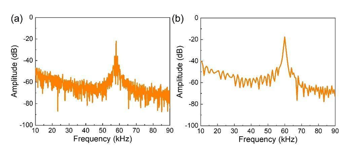
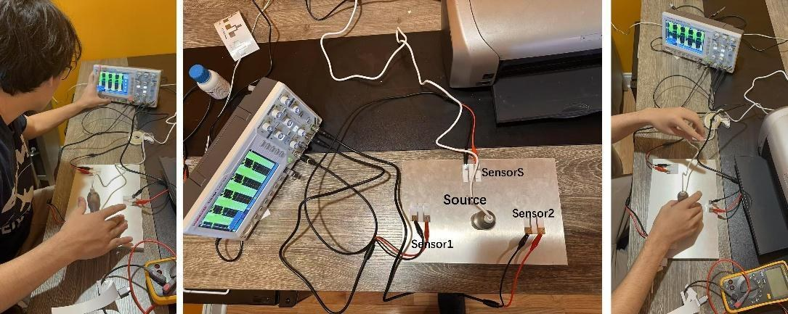
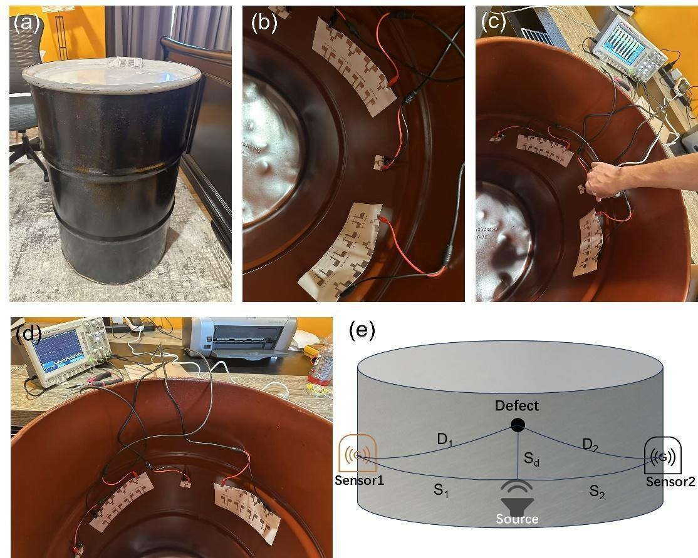
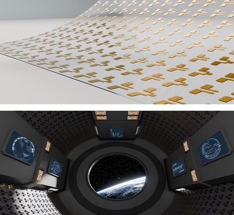

# Inkjet-Printed Ultrasonic Sensor for Structural Health Monitoring

**Piezoelectric sensors for spacecraft and aerospace SHM applications**

[]()
<!-- TODO: add verified Google Patents or USPTO public document URL if/when this provisional or a later nonprovisional is published. No public page was found as of 2026-11-10. -->
[]()
[]()

## Overview

This project develops **inkjet-printed piezoelectric ultrasonic sensors** for laboratory-stage structural health monitoring (SHM) of aerospace structures, with plate and tank experiments and COMSOL simulations described in the author’s manuscript. Sensors are fabricated by inkjet printing silver-nanoparticle electrodes onto polymer films, including PVDF for the piezoelectric devices.

## Key Results

Numbers below are taken from the author’s manuscript, *Inkjet-Printed Piezoelectric Nanomaterial Arrays for Autonomous Structural Health Monitoring in Spacecraft and Deep-Space Exploration*. The work is at the laboratory stage.

### Plate localization experiments (§VI)

An 8×12 in aluminum plate, 1.5 in thick, with a hole at the center, was tested at 60 kHz. In the first attempt the manuscript reports Source (0, 0), Sensor1 (−6, −4), Sensor2 (6, −4), delays Δt₁ = 80.2 μs, Δt₂ = 13.9 μs, Δt₃ = 13.9 μs, and S₁ = S₂ = 7.2 in, yielding a stated defect position of (−0.02, −4.01) in versus an actual position of (0, −4) in, “a measurement error of only 0.3%.”

Table 4 of the manuscript lists three further trials (coordinates in inches, delays in microseconds):

| Trial | Source | Δt_S (μs) | Sensor1 | Δt₁ (μs) | Sensor2 | Δt₂ (μs) | Xd | Yd | Error |
|-------|--------|-----------|---------|----------|---------|----------|------|------|-------|
| 1 | (0, 0) | 40.1 | (0, −8) | 0.13 | (6, −4) | 13.8 | 0.02 | −4.02 | 0.5% |
| 2 | (6, 0) | 71.9 | (0, −8) | 5.33 | (6, −4) | 25.8 | 0.01 | 4.04 | 1.0% |
| 3 | (6, 0) | 72.2 | (−6, −8) | 0.08 | (6, −4) | 26.1 | −0.03 | −4.05 | 1.3% |

The manuscript text also describes the relative error as about 1% and as ~1%. The printed Table 4 errors are 0.5%, 1.0%, and 1.3%.

### Sensor responses and comparison (§V)

| Quantity | Value | Source |
|----------|-------|--------|
| Triboelectric voltage amplitudes | typically 0.1–1.7 V | §V Evaluation |
| PVDF piezoelectric maximum voltage | ~0.25 V | §V Evaluation |
| PDMS/PI triboelectric FFT peak | 58.0 kHz | §V / Figure 9 |
| PVDF piezoelectric FFT peak | 59.9 kHz | §V / Figure 9 |
| Excitation frequency | 60 kHz | §V and §VI |
| Printed sensor size / weight / price | 0.4 in, 0.005 lb, $0.1 (sensor array) | Table 3 |

Table 3 lists commercial ultrasonic probes at 0.9–2 in, 0.5–0.6 lb, and $900–$1,400. The manuscript states that this approach reduces deployment costs by 99% (conclusion: nearly 99%).

A 55-gallon tank (23 in diameter, 34 in height) was also tested. The manuscript reports a measured defect position of (θ = 0.043, Y = 0.5 in) versus an actual site of (θ = 0, Y = 0.5 in).

The manuscript abstract states approximately 1% localization error and that the printed sensors outperform commercial ultrasonic sensors by 38% in sensitivity. The conclusion repeats approximately 38% higher sensitivity compared with commercial ultrasonic or triboelectric sensors, and approximately 1% localization error. Fabrication is by inkjet printing (Epson R230; Mitsubishi Paper Mills silver nanoparticle ink) on polymer substrates including PVDF.

### Simulation (§V.A)

A titanium-alloy cylindrical tube, 10 in in diameter and 31.5 in high, with a 0.2 in defect, was modeled in COMSOL. A 60 kHz Gaussian pulse of 16.7 μs was applied. The manuscript states that wavefront interference at t = 175 μs localized defects within ±0.02 in.

## Technology

### Sensing Principle
Piezoelectric ultrasonic transducers generate and receive guided Lamb waves that propagate through structural materials. Changes in wave characteristics (amplitude, time-of-flight, frequency content) indicate the presence and location of structural damage.

### Innovation
- **Inkjet-printed fabrication** enables conformal sensor arrays on complex geometries
- **Nanomaterial-based piezoelectric inks** optimized for ultrasonic frequency response
- **Signal processing algorithms** for automated damage detection and localization

### Methods summary (from the manuscript)

- Electrodes were inkjet-printed with an Epson R230 household printer and Mitsubishi Paper Mills silver nanoparticle ink, on polymer films. Piezoelectric devices used a PVDF dielectric; triboelectric devices used stacked pairs such as PDMS/PI, PDMS/PET, and PET/PI.
- Frequency-response tests were performed on an aluminum plate at 60 kHz, with the printed sensor 0.5 in from the source and a Hantek DOS1104 oscilloscope for acquisition. A coupling layer was used to reduce the air-gap impedance.
- Defect localization was measured on an 8×12 in, 1.5 in thick aluminum plate with a central hole, and on the inner wall of a 55-gallon propane tank (23 in diameter, 34 in height). The speed of sound in aluminum is given as 5000 m/s. A MATLAB routine (Figure 13 and Appendix B) was used to compute defect coordinates from time delays.
- COMSOL finite-element simulations of a titanium-alloy tube are described in §V.A (10 in diameter, 31.5 in height, 0.2 in defect, 0.005 in mesh, 60 kHz / 16.7 μs pulse).

## Figures

Photographs and figures below are from [maxkopptech.com/space-monitoring](https://maxkopptech.com/space-monitoring/) unless noted. Captions describe only what is visible. Concept stills are labeled as illustrations. The 200 g plot is a printed pressure-sensor trace as labeled on the figure; it is not a plot of the ~1% localization or 38% sensitivity figures stated above.


*Laboratory photograph: printed sensor elements taped to the inner wall of a metal drum and wired to a Hantek oscilloscope.*


*Laboratory bench: a metal plate with printed electrode pads and a central transducer, wired to a Hantek oscilloscope, with an inkjet printer at the top of the frame.*


*Laboratory photograph of a desktop inkjet printer with refillable ink cartridges (highlighted in the original image).*


*Laboratory bench photograph showing an inkjet printer, oscilloscope, microscope, a wired metal plate, and a metal drum beside the desk.*


*Photograph of Maximilian B. Kopp presenting a talk titled “Inkjet-Printed, Deployable Ultrasonic Sensors for Real-Time Structural Health Monitoring in Deep-Space Missions,” with JSHS and Temple University College of Science and Technology marks on the slide. From the maxkopptech.com media library.*


*Figure from the site labeled “Figure 2 Structure of the fully printed pressure sensor components,” with a resistance (kΩ) versus time (s) trace marked “200 g,” plus a render of a flexible sheet of gold electrode patterns. This figure shows a printed pressure-sensor response under 200 g; it does not itself display the ~1% localization or 38% sensitivity figures.*


*Illustration (3D concept still) of a proposed on-orbit inkjet-printing kit, labeled on the image: piezoelectric film, nanoparticle ink, inkjet printer, “Electronic Clipper,” and cable.*


*Illustration (3D concept still) of concentric localization rings overlaid on a spacecraft model.*

## Figures from the manuscript

The photographs in the previous section are from the author’s site. The figures below are taken from the inkjet SHM manuscript. Equation drawings and a correspondence appendix were not included. Full captions are in [`figures/paper/README.md`](figures/paper/README.md).

*From Kopp, M. B., Inkjet-Printed Piezoelectric Nanomaterial Arrays for Autonomous Structural Health Monitoring in Spacecraft and Deep-Space Exploration (manuscript).*



*Manuscript Figure 1: Simulation model of a titanium-alloy cylindrical tube (10 in diameter, 31.5 in height) with a 0.2 in defect, and the 60 kHz, 16.7 μs Gaussian pulse.*



*Manuscript Figure 7: Laboratory test setup for the printed ultrasonic sensors.*



*Manuscript Figure 9: FFT spectra of (a) a PDMS/PI triboelectric sensor and (b) a PVDF piezoelectric sensor. The text states peaks at 58.0 kHz and 59.9 kHz. Point values were not digitized.*



*Manuscript Figure 10: Measurement setup for defect localization on an aluminum plate with printed sensors and an oscilloscope.*



*Manuscript Figure 14: Test setup on a 55-gallon tank, with printed sensors on the inner wall.*



*Manuscript Figure 16 (application graphic): Concept illustration of printable ultrasonic sensors in aerospace applications. The manuscript also labels a MATLAB-code screenshot as Figure 16.*


## Awards & Recognition

- **U.S. Navy Environmental Science Award** (2025)
- **Air Force Certificate of Achievement** (2025)
- **W.L. Gore & Associates Engineering First Award** (2025)
- Presented findings to the **Chief of Naval Research**; commended by ONR and AFRL leadership

## Intellectual Property

U.S. Provisional Patent Application No. 63/775,901 — *Inkjet-Printed Ultrasonic Sensor for Structural Health Monitoring*

## Tools & Technologies

- **Simulation:** COMSOL Multiphysics (wave propagation modeling)
- **Signal Processing:** MATLAB, Python
- **Fabrication:** Inkjet printing of piezoelectric nanomaterials
- **Hardware:** Arduino-based data acquisition

## How to reproduce

```bash
python src/reproduce_inkjet_results.py
```

The script loads the packaged CSVs and checks:

- Table 3: 1 − 0.1/900 is at least 99%, consistent with the manuscript’s “nearly 99%” cost reduction.
- First-attempt arithmetic: the distance from the stated (−0.02, −4.01) in to the actual (0, −4) in, divided by the stated 7.2 in, rounds to the stated 0.3%.

## Repository Structure

```
inkjet-ultrasonic-sensor/
├── data/               # Numbers and tables stated in the manuscript
├── figures/            # Site photographs, plus figures/paper/ from the manuscript
├── src/                # Existing utilities, plus reproduce_inkjet_results.py
├── README.md
├── requirements.txt
└── LICENSE
```

## License

This project is licensed under the MIT License. See [LICENSE](LICENSE) for details.

## Contact

**Maximilian Kopp** — [maxkopp2007@gmail.com](mailto:maxkopp2007@gmail.com) | [maxkopptech.com](https://www.maxkopptech.com) | [ORCID](https://orcid.org/0009-0008-6431-8137) | [LinkedIn](https://www.linkedin.com/in/maxkopp)
