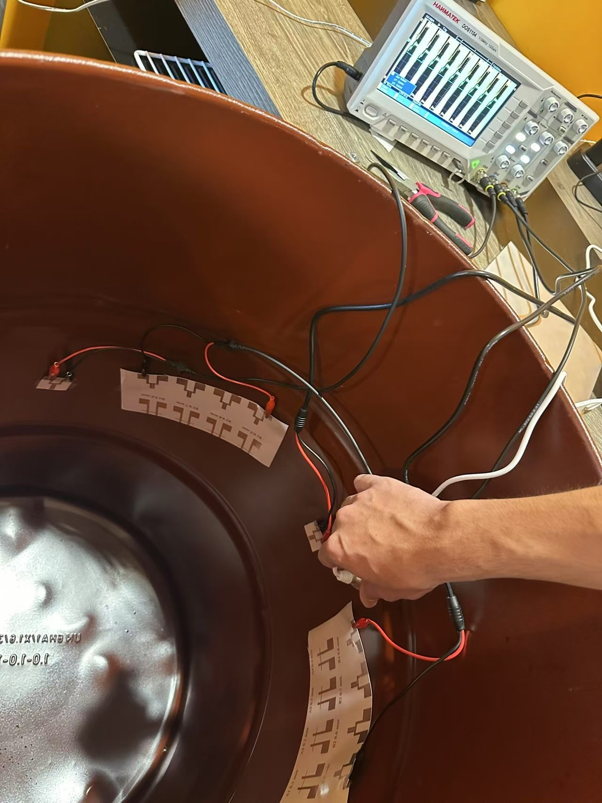
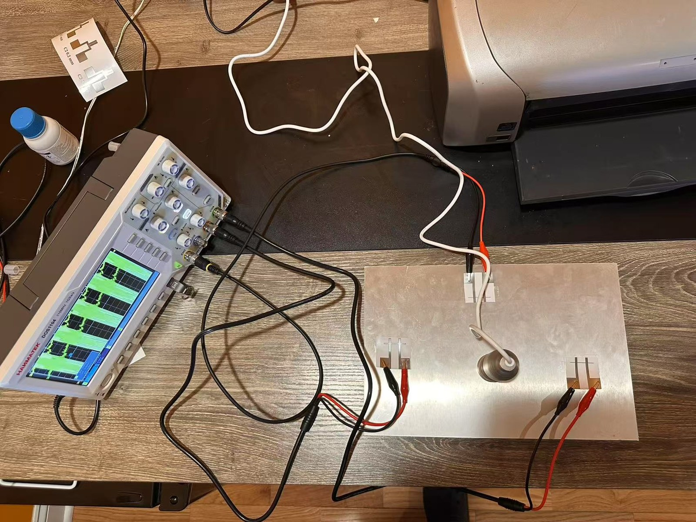
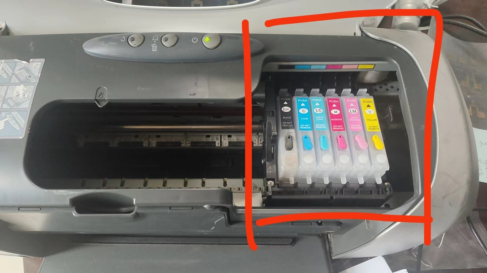
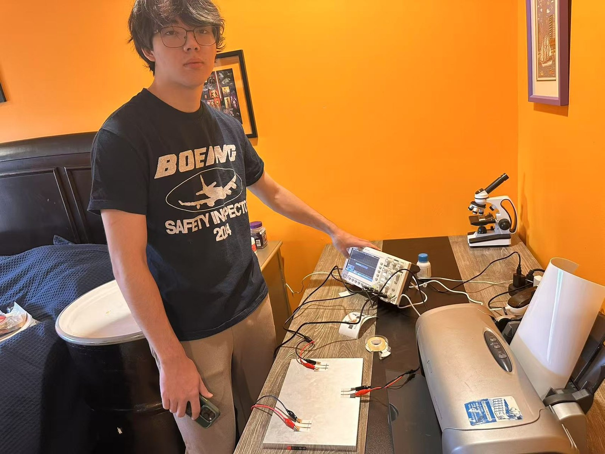
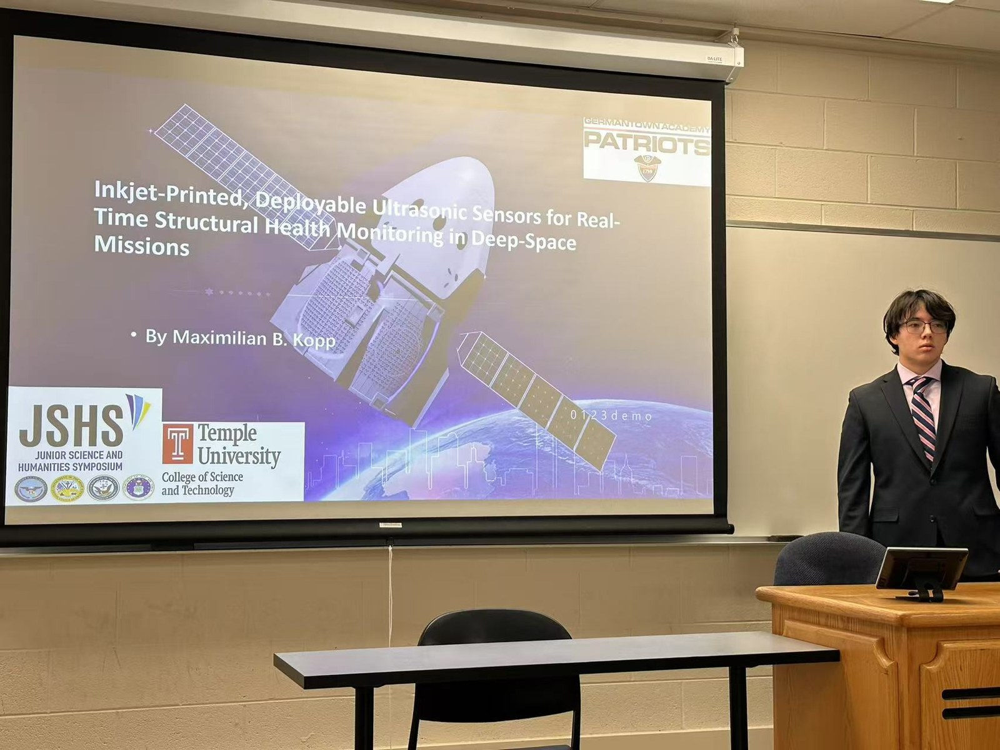
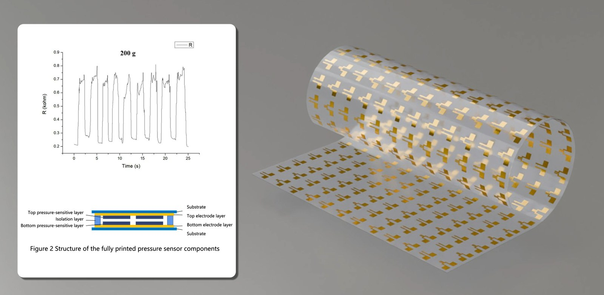
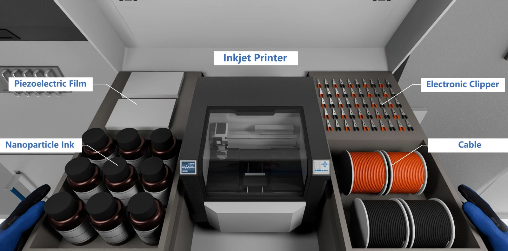
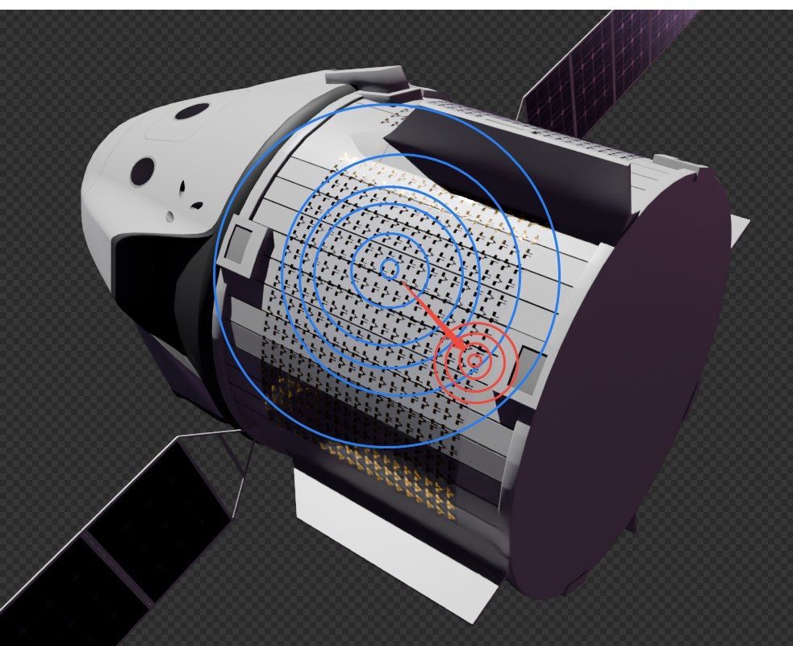

# Inkjet-Printed Ultrasonic Sensor for Structural Health Monitoring

**Piezoelectric sensors for spacecraft and aerospace SHM applications**

[]()
<!-- TODO: add verified Google Patents or USPTO public document URL if/when this provisional or a later nonprovisional is published. No public page was found as of 2026-11-10. -->
[]()
[]()

## Overview

This project develops **inkjet-printed piezoelectric ultrasonic sensors** for real-time structural health monitoring (SHM) of spacecraft and aerospace structures. The sensors achieve superior performance compared to commercial transducers while enabling scalable, low-cost manufacturing through additive fabrication.

## Key Results

| Metric | Value |
|--------|-------|
| Damage Localization Error | **< 1%** |
| Sensitivity vs. Commercial | **38% higher** |
| Fabrication Method | Inkjet printing |
| Target Application | Spacecraft SHM |

## Technology

### Sensing Principle
Piezoelectric ultrasonic transducers generate and receive guided Lamb waves that propagate through structural materials. Changes in wave characteristics (amplitude, time-of-flight, frequency content) indicate the presence and location of structural damage.

### Innovation
- **Inkjet-printed fabrication** enables conformal sensor arrays on complex geometries
- **Nanomaterial-based piezoelectric inks** optimized for ultrasonic frequency response
- **Signal processing algorithms** for automated damage detection and localization

## Figures

Photographs and figures below are from [maxkopptech.com/space-monitoring](https://maxkopptech.com/space-monitoring/) unless noted. Captions describe only what is visible. Concept stills are labeled as illustrations. The 200 g plot is a printed pressure-sensor trace as labeled on the figure; it is not a plot of the sub-1% localization or 38% sensitivity figures stated above.



*Laboratory photograph: printed sensor elements taped to the inner wall of a metal drum and wired to a Hantek oscilloscope.*



*Laboratory bench: a metal plate with printed electrode pads and a central transducer, wired to a Hantek oscilloscope, with an inkjet printer at the top of the frame.*



*Laboratory photograph of a desktop inkjet printer with refillable ink cartridges (highlighted in the original image).*



*Laboratory bench photograph showing an inkjet printer, oscilloscope, microscope, a wired metal plate, and a metal drum beside the desk.*



*Photograph of Maximilian B. Kopp presenting a talk titled “Inkjet-Printed, Deployable Ultrasonic Sensors for Real-Time Structural Health Monitoring in Deep-Space Missions,” with JSHS and Temple University College of Science and Technology marks on the slide. From the maxkopptech.com media library.*



*Figure from the site labeled “Figure 2 Structure of the fully printed pressure sensor components,” with a resistance (kΩ) versus time (s) trace marked “200 g,” plus a render of a flexible sheet of gold electrode patterns. This figure shows a printed pressure-sensor response under 200 g; it does not itself display the sub-1% localization or 38% sensitivity figures.*



*Illustration (3D concept still) of a proposed on-orbit inkjet-printing kit, labeled on the image: piezoelectric film, nanoparticle ink, inkjet printer, “Electronic Clipper,” and cable.*



*Illustration (3D concept still) of concentric localization rings overlaid on a spacecraft model.*

## Awards & Recognition

- **U.S. Navy Environmental Science Award** (2025)
- **Air Force Certificate of Achievement** (2025)
- **W.L. Gore & Associates Engineering First Award** (2025)
- Presented findings to the **Chief of Naval Research**; commended by ONR and AFRL leadership

## Intellectual Property

U.S. Provisional Patent Application No. 63/775,901 — *Inkjet-Printed Ultrasonic Sensor for Structural Health Monitoring*

## Tools & Technologies

- **Simulation:** COMSOL Multiphysics (wave propagation modeling)
- **Signal Processing:** MATLAB, Python
- **Fabrication:** Inkjet printing of piezoelectric nanomaterials
- **Hardware:** Arduino-based data acquisition

## Repository Structure

```
inkjet-ultrasonic-sensor/
├── figures/            # Laboratory photographs, a labeled 200 g pressure-sensor figure, and concept illustrations
├── src/
├── README.md
├── requirements.txt
└── LICENSE
```

## License

This project is licensed under the MIT License. See [LICENSE](LICENSE) for details.

## Contact

**Maximilian Kopp** — [maxkopp2007@gmail.com](mailto:maxkopp2007@gmail.com) | [maxkopptech.com](https://www.maxkopptech.com) | [ORCID](https://orcid.org/0009-0008-6431-8137) | [LinkedIn](https://www.linkedin.com/in/maxkopp)
